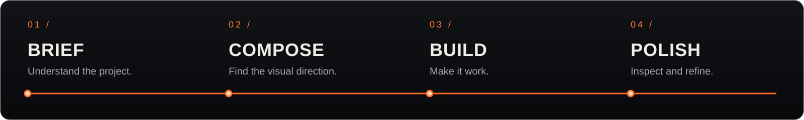
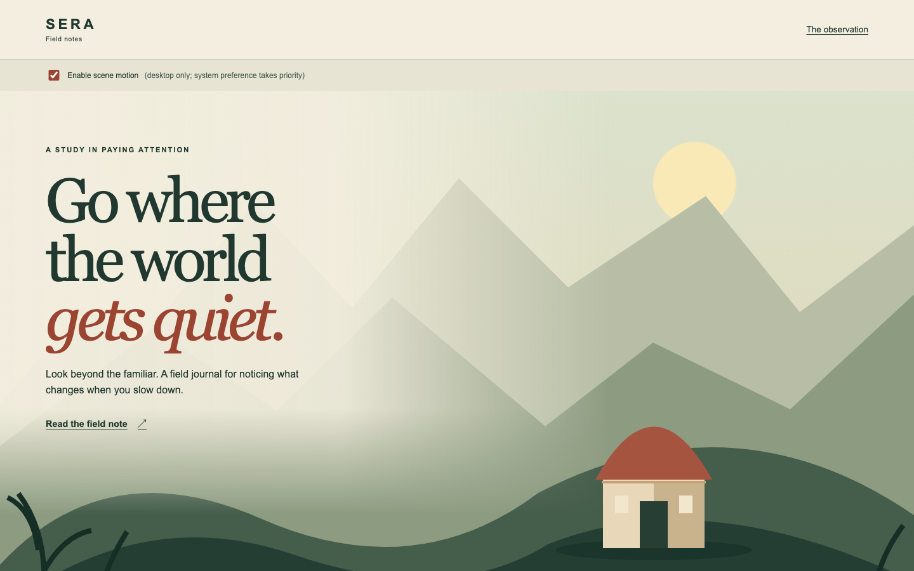

<div align="center">


<br>


### Make the website fit the story.

**[Install](#install)** &nbsp; · &nbsp; **[Use](#use)** &nbsp; · &nbsp; **[Explore the recipes](#four-runnable-recipes)** &nbsp; · &nbsp; **[Validation](docs/validation.md)**

<sub>Created by <a href="https://github.com/dominicvenox">Dominic Gerber</a>.</sub>

</div>

A website skill for Codex and Claude Code, combining considered visual design with
an optional immersive scroll workflow. Build a clear company site, an editorial
portfolio, a product storefront or an expressive launch page. The brief determines
the look, structure and amount of movement.

**Venox is the name of the tool, not a preset visual identity.** Your website keeps
its own brand; this repository wears ours.



## Install

Download [venox-website.zip from v0.1.0](https://github.com/dominicvenox/venox-web/releases/tag/v0.1.0).
The archive contains one `venox-website/` directory. Extract that directory into
**one** of the relevant locations:

| Agent | For one project | For your account |
| --- | --- | --- |
| Codex | `.agents/skills/` | `~/.agents/skills/` |
| Claude Code | `.claude/skills/` | `~/.claude/skills/` |

Existing Codex desktop installations may manage personal skills in
`$CODEX_HOME/skills` (usually `~/.codex/skills`). Use the location already managed by
your app rather than installing a second copy of the same skill. If the selector
does not refresh, restart the agent. Keep existing installations until you are ready
to replace that specific skill directory; do not copy over unrelated skills.

Alternatively, ask Codex's skill installer to install the `skills/venox-website`
folder from this repository. No npm install, API key, hook or background process is
needed to use the skill. The optional developer tools below are separate.

## Use

In Codex:

```text
$venox-website build a calm, image-led website for an independent architecture studio
$venox-website refine this storefront while keeping its brand and checkout flow
$venox-website animate this product story with a short pinned sequence
$venox-website audit the current website; report findings without editing it
```

In Claude Code:

```text
/venox-website build an immersive launch page using the supplied product photography
/venox-website polish the mobile navigation and typography
```

German works too:

```text
$venox-website Plane eine Website für ein regionales Handwerksunternehmen.
/venox-website Überarbeite diese Landingpage. Behalte Logo, Farben und Funktionen.
$venox-website Prüfe die Scroll-Animation auf Mobilgeräten, ohne Code zu ändern.
```

Natural language takes priority over mode labels. The seven modes are `plan`,
`build`, `refine`, `redesign`, `animate`, `audit` and `polish`. Planning and auditing
leave website source unchanged; review evidence may be saved separately.
The agent can also select Venox when a request matches its description.

## What it does

1. Reads the existing project, content and brand before selecting a direction.
2. Asks only about missing decisions that materially affect the work.
3. Builds around audience, hierarchy, composition and a useful next action.
4. Uses deliberate motion when it serves the experience, including mobile and
   reduced-motion versions.
5. Inspects the result in a browser, separating observed defects from design judgment.

Larger builds and redesigns may use a short development-only `VENOX-BRIEF.md`.
Small edits do not require extra planning documents. Existing frameworks, design
systems and hosting workflows remain the starting point.

## Four runnable recipes

These are independent HTML/CSS/JavaScript examples to inspect and adapt. They do
not install a universal runtime or prescribe a complete page template.

| Recipe | What it demonstrates |
| --- | --- |
| [Layered hero](skills/venox-website/assets/recipes/layered-hero/index.html) | Depth from separate visual planes, grounded composition and readable HTML type. |
| [Pinned story](skills/venox-website/assets/recipes/pinned-story/index.html) | A short scroll-led sequence with a normal reading layout as its fallback. |
| [Horizontal gallery](skills/venox-website/assets/recipes/horizontal-gallery/index.html) | An editorial rail that remains manually usable on narrow screens. |
| [Video scrub](skills/venox-website/assets/recipes/video-scrub/index.html) | Supplied local video, scroll-to-time seeking, poster and error handling. |

Each example includes lifecycle cleanup, resize handling, static HTML content and
live reduced-motion handling. Video is optional: select an optimized local file in
the demo. No generated assets, hosting account or media API is bundled.



## Optional developer tools

Use Node.js 22 or later from a checkout of this repository:

```sh
npm ci
npx playwright install chromium
npm run preview
```

Open `http://127.0.0.1:4173/layered-hero/`, `…/pinned-story/`,
`…/horizontal-gallery/` or `…/video-scrub/`. These are ES modules; serve the
examples over HTTP rather than opening them as `file://` documents.

```sh
npm run validate
npm test
npm run capture -- --url http://127.0.0.1:4173 --out work/captures --config docs/capture.example.json
npm run pack:skill -- --out dist/venox-website.zip
```

The capture tool uses Playwright Chromium and makes no form submissions or source
edits. It writes a fresh result directory containing screenshots and a JSON report.
Exit `0` means capture completed without observed objective findings, `2` means it
completed with findings, and `1` means an operational failure. None of those outcomes
is a visual quality score or an accessibility certification.

See [tooling and configuration](docs/tooling.md), [validation evidence](docs/validation.md)
and [behavior scenarios](docs/behavior-tests.md). Browser dependencies are needed for
repository tests, not for reading or installing the skill.

## Package and compatibility

`skills/venox-website/` is the only authored skill source. The release ZIP includes
that folder's instructions, references, examples and license notices. Repository
scripts, tests, development dependencies and screenshots are excluded.

The same skill content is used by both agents. Codex UI metadata lives in
`agents/openai.yaml`; core instructions do not rely on provider-specific tool names,
hooks, command substitution or model identifiers. Feature availability depends on
the host: without browser access, the agent reports that visual QA is unverified.

The initial release focuses on website design and frontend execution. Payment services,
commerce backends and media generation use the tools and authorization of the
particular project. The examples do not provide those services.

## Development

Edit the canonical skill or a focused recipe, add a regression case for behavioral
changes, and run `npm run check`. CI validates the package and exercises browser
recipes. Use [the independent behavior scenarios](docs/behavior-tests.md) when
changing the skill workflow; avoid tests that merely match its wording.

Release versions follow semantic versioning. Package with `npm run pack:skill`,
review the archive, then publish the matching tag and ZIP. No auto-update mechanism
changes an installed skill.

## License

Copyright (c) 2026 Dominic Gerber. Released under the [MIT License](LICENSE).

The optional development dependencies retain their own licenses and are not included
in the standalone skill ZIP.

<br>

<div align="center">


**VENOX** &nbsp; / &nbsp; DESIGN. BUILD. REFINE.

<sub>[SEO + GEO](https://github.com/dominicvenox/venox-seogeo) &nbsp; · &nbsp; [Lern mich kennen](https://github.com/dominicvenox/lern-mich-kennen)</sub>

</div>
